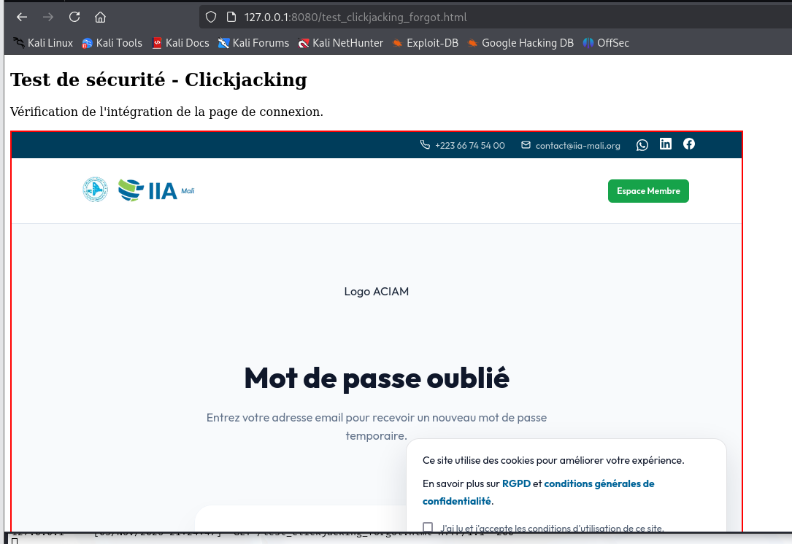
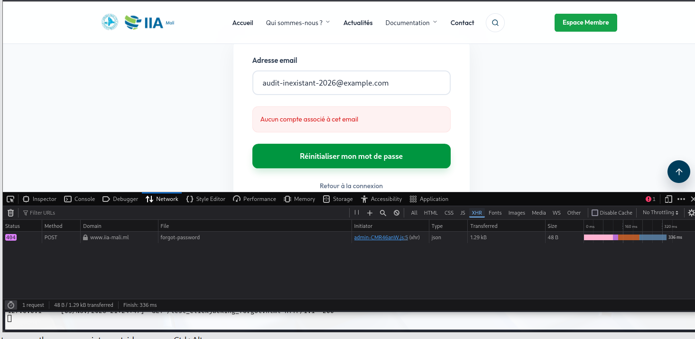
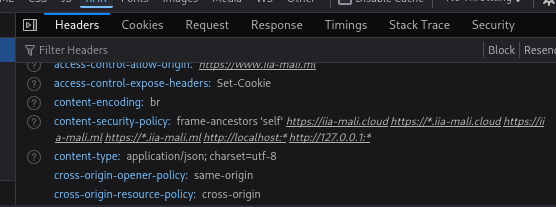
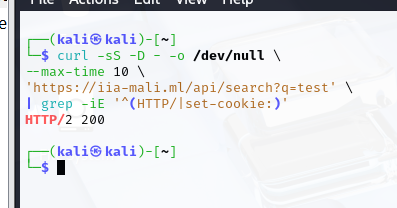
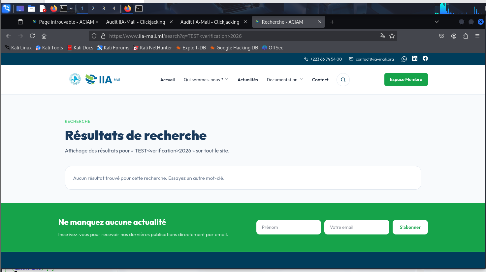
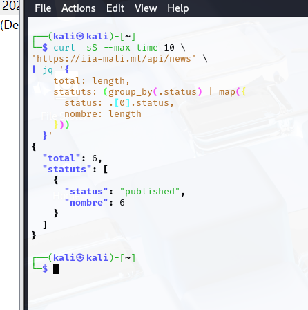
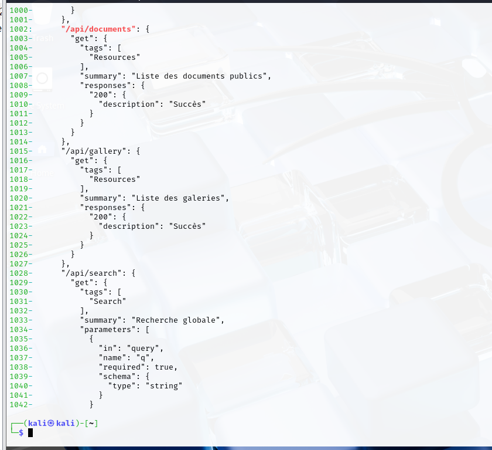

# 🔐 Audit de sécurité web — IIA Mali

### Web Security Assessment | Cybersecurity Portfolio

**Réalisé par : Matine Lolita GNAMKOULAMBA**

**Domaine :** Cybersécurité | Sécurité des applications web | API Security

---

## 📌 1. Présentation du projet

Ce projet présente une évaluation de la sécurité d'une
application web, réalisée avec l'autorisation de son propriétaire.

L'objectif est d'analyser différents mécanismes de sécurité,
d'identifier les configurations nécessitant une amélioration
et de proposer des recommandations adaptées.

L'audit repose sur une démarche méthodologique inspirée
des bonnes pratiques OWASP.

---

## 📄 Rapport complet d'audit

Le rapport présente la méthodologie utilisée, les tests
effectués, les observations techniques et les recommandations
de sécurité.

📥 **[Consulter le rapport complet d'audit de sécurité](Rapport_Audit_IIA_Mali.pdf)**

**Auditrice :** Matine Lolita GNAMKOULAMBA

**Outils utilisés :** Kali Linux, Firefox Developer Tools,
cURL et Python.

**Référentiel méthodologique :** OWASP.

---

## 🎯 2. Objectifs de l'audit

- Examiner les mécanismes d'authentification.
- Analyser le processus de réinitialisation des mots de passe.
- Vérifier les en-têtes de sécurité HTTP.
- Étudier les politiques CORS.
- Évaluer les protections contre le clickjacking.
- Examiner les réponses des API publiques.
- Vérifier le traitement des données saisies par les utilisateurs.
- Formuler des recommandations de sécurisation.

## 🛠️ 3. Environnement technique

| Catégorie | Technologies et outils |
|---|---|
| Système d'exploitation | Kali Linux |
| Navigateur | Mozilla Firefox |
| Analyse HTTP | curl |
| Inspection web | Firefox Developer Tools |
| Analyse JSON | Python 3 |
| Référentiel de sécurité | OWASP |
| Documentation | Markdown, PDF |

## 🔎 4. Travaux réalisés

### 4.1 Analyse de l'authentification

Inspection du formulaire de connexion et des mécanismes
de validation des champs.

### 4.2 Réinitialisation des mots de passe

Analyse du comportement du formulaire de récupération
de compte et des réponses HTTP associées.

### 4.3 Sécurité des API

Inspection des réponses JSON d'une API publique,
de leur structure et des informations retournées.

### 4.4 En-têtes de sécurité HTTP

Vérification de plusieurs mécanismes :

- HTTP Strict Transport Security (HSTS)
- Content Security Policy (CSP)
- X-Content-Type-Options
- Referrer-Policy
- X-Frame-Options

### 4.5 Politique CORS

Analyse des en-têtes Cross-Origin Resource Sharing
et des réponses aux requêtes préliminaires OPTIONS.

### 4.6 Protection contre le clickjacking

Vérification du comportement des pages lorsqu'elles
sont intégrées dans une iframe.

### 4.7 Validation des entrées

Observation du traitement et de l'affichage
des paramètres de recherche.

## 📊 5. Synthèse des observations

Les vérifications réalisées ont permis d'identifier
plusieurs éléments nécessitant une analyse de configuration
ou des améliorations potentielles.

Les tests documentés ne permettent pas de conclure
à une compromission du système.

Les observations portent notamment sur :

- La cohérence des en-têtes de sécurité.
- La configuration des politiques CORS.
- Les mécanismes de protection contre le clickjacking.
- Les messages retournés par le processus
  de réinitialisation des mots de passe.

## 🛡️ 6. Recommandations générales

- Harmoniser les en-têtes de sécurité HTTP.
- Appliquer une politique CSP adaptée aux fonctionnalités.
- Vérifier les origines autorisées par les API.
- Réduire les risques de divulgation d'informations
  dans les réponses d'authentification.
- Maintenir une validation rigoureuse des entrées.
- Mettre en place des contrôles de sécurité réguliers.

## 📁 7. Documentation

Le dépôt est destiné à regrouper :

- Le rapport d'audit au format PDF.
- Les captures d'écran des tests.
- La méthodologie utilisée.
- Les recommandations de sécurité.

## ⚖️ 8. Cadre éthique

Cette évaluation a été réalisée avec l'autorisation
du propriétaire du site.

Les observations présentées correspondent aux tests
effectivement réalisés et aux preuves collectées.

Aucune compromission du système n'a été démontrée
dans le cadre des vérifications documentées.

---

## 👩‍💻 À propos de l'auteure

**Matine Lolita GNAMKOULAMBA**

Master en Cybersécurité, Cloud & Systèmes.

Compétences en administration systèmes, support informatique,
réseaux et sécurité des environnements informatiques.

Ce projet illustre une démarche pratique d'analyse
de la sécurité des applications web, de documentation
technique et de formulation de recommandations.

---

**Projet de portfolio — Cybersécurité**

---

## 📸 Preuves techniques — Captures d'écran

Cette section présente les principales vérifications réalisées
dans le cadre de l'audit de sécurité web IIA Mali.

### 1. Vérification du Clickjacking

### 2. Analyse de la réinitialisation du mot de passe

### 3. Analyse des en-têtes de sécurité HTTP

### 4. Vérification de la politique CORS

### 5. Vérification de la réflexion des entrées utilisateur

### 6. Analyse de l'API des actualités

### 7. Analyse de la structure des réponses API

---

**Audit réalisé par : Matine Lolita GNAMKOULAMBA**
